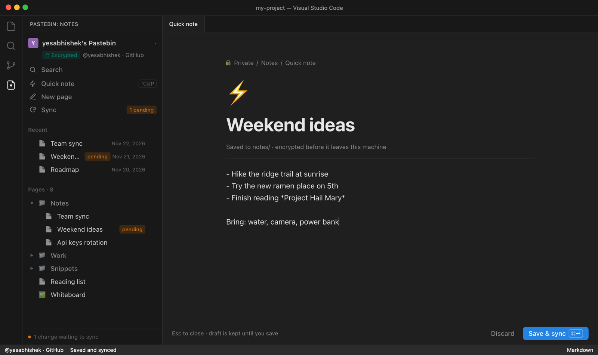
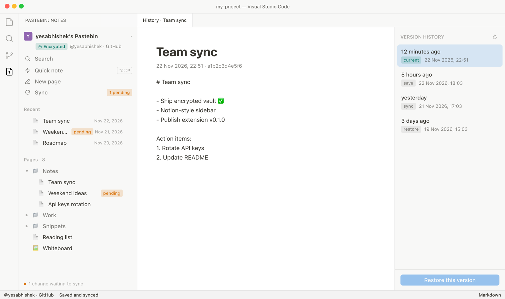
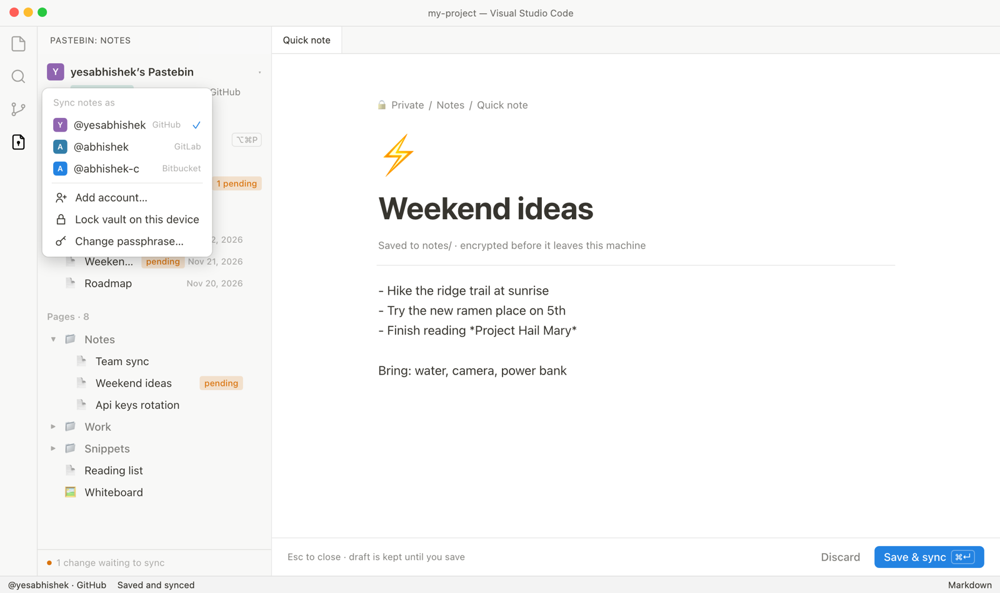
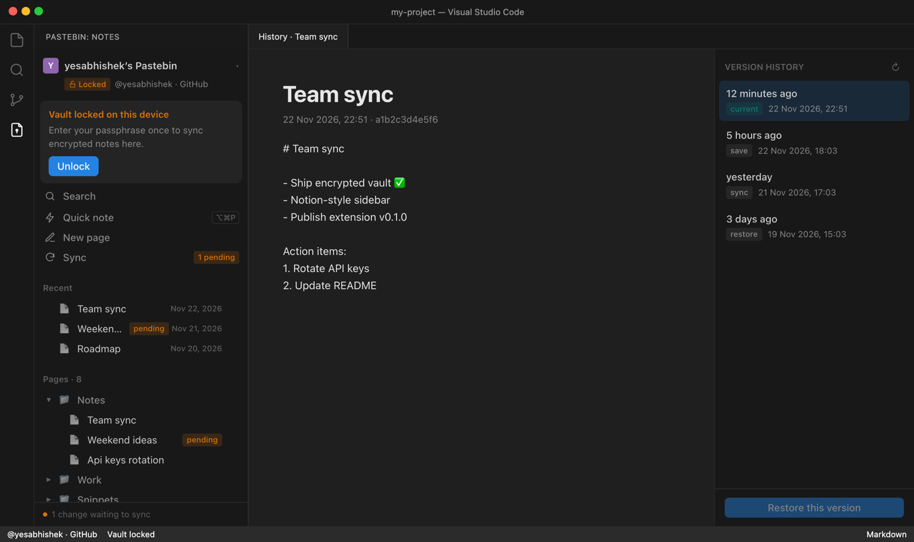

<p align="center">
  
</p>

<h1 align="center">pb</h1>

<p align="center">
  End-to-end encrypted notes that sync through a private Git repository you own,<br>
  on <b>GitHub</b>, <b>GitLab</b> or <b>Bitbucket</b>. A fast CLI plus a VS Code extension.
</p>

<p align="center">
  
</p>

---

## Why pb

- **Private by design.** Note contents, note names and the index are encrypted with AES-256-GCM on your machine. Your Git host only ever stores ciphertext under random-looking object IDs.
- **Bring your own Git host.** Store notes in a private repository on GitHub, GitLab (gitlab.com or self-managed) or Bitbucket Cloud. There is no pb server and no subscription.
- **Every machine you use.** Unlock once per device with your passphrase. The key is then kept in the OS keychain (macOS Keychain, Windows Credential Manager or Secret Service on Linux).
- **Quick capture.** Press <kbd>⌥⌘P</kbd> (<kbd>Ctrl+Alt+P</kbd>) in VS Code, or run `pb note "…"` in a terminal.
- **Full version history.** Every save is a version you can browse, decrypt and restore.
- **Multiple accounts.** See which account and repository you sync to, and switch between them at any time.
- **Offline-first.** Edits are cached locally and sync when you're back online. Conflicts create a copy instead of overwriting.

## Supported Git hosts

| Host | Sign-in | Notes |
|---|---|---|
| **GitHub** | GitHub CLI (`gh auth login`) | Per-file compare-and-swap on every write |
| **GitLab** (gitlab.com or self-managed) | `pb login gitlab`, using a personal access token with the `api` scope | Writes use `last_commit_id`, so concurrent edits are rejected |
| **Bitbucket Cloud** | `pb login bitbucket --email <atlassian-email>`, using an API token with repository read/write/admin and account read scopes | pb re-checks the file's latest commit immediately before each write |

pb refuses to use a repository that is not private on any of these hosts. Tokens for GitLab and Bitbucket are stored in your OS keychain, never in config files.

## Install

### CLI

macOS / Linux:

```bash
curl -fsSL https://raw.githubusercontent.com/yesabhishek/pastebin-cli/main/scripts/install.sh | sh
```

Windows (PowerShell):

```powershell
iwr https://raw.githubusercontent.com/yesabhishek/pastebin-cli/main/scripts/install.ps1 -useb | iex
```

The installers verify the release's `SHA256SUMS` before installing and need no sudo or admin rights.

From source (Go 1.26+):

```bash
git clone https://github.com/yesabhishek/pastebin-cli.git
cd pastebin-cli && go build -o pb ./cmd/pb
```

### VS Code extension

Search for **Pastebin — Encrypted Notes** in the Extensions view, or install it from the [Visual Studio Marketplace](https://marketplace.visualstudio.com/items?itemName=AbhishekChoudhury.pastebin-vscode). It uses the `pb` CLI underneath.

## Quick start

**GitHub**

```bash
gh auth login
pb init                         # creates a PRIVATE repo and sets your passphrase
```

**GitLab**

```bash
pb login gitlab                 # add --host git.example.com for self-managed GitLab
pb account switch gitlab:<your-username>
```

**Bitbucket**

```bash
pb login bitbucket --email you@example.com
pb account switch bitbucket:<your-username>   # add --workspace <slug> for a team workspace
```

Then, on any host:

```bash
pb note "call the bank at 3pm"  # quick note -> notes/2026-11-22-1405-call-the-bank-at-3pm.md
pb list
pb sync
```

On another machine, sign in to the same account and run `pb init` (GitHub) or `pb account switch <provider:login>`. pb asks for your passphrase once, then syncs.

### Upgrading from pb 0.2 or earlier (unencrypted repositories)

```bash
pb encrypt
```

This sets a passphrase, encrypts every existing note and deletes the plaintext copies. Older pb releases are locked out of the repository on purpose, so they cannot upload plaintext again. Upgrade pb on all your machines.

Encryption cannot rewrite history that was already pushed, so older plaintext versions remain in that repository's commit history. To remove them, start a fresh repository with `pb --repo pastebin-vault init` and delete the old one on your Git host.

## VS Code extension

<table>
  <tr>
    <td width="50%"><br><sub><b>Version history.</b> Browse decrypted past versions and restore with one click.</sub></td>
    <td width="50%"><br><sub><b>Accounts.</b> See where you sync and switch between GitHub, GitLab and Bitbucket.</sub></td>
  </tr>
  <tr>
    <td width="50%"><br><sub><b>Quick note.</b> Press <kbd>⌥⌘P</kbd>, type, then <kbd>⌘↵</kbd> to encrypt, save and sync.</sub></td>
    <td width="50%"><br><sub><b>New device.</b> Unlock once with your passphrase and everything syncs.</sub></td>
  </tr>
</table>

| Feature | How |
|---|---|
| Sidebar | Page tree with search (<kbd>/</kbd>), recent pages, folders and sync status |
| Quick note | <kbd>⌥⌘P</kbd> / <kbd>Ctrl+Alt+P</kbd> opens a capture page. <kbd>⌘↵</kbd> encrypts, saves and syncs |
| Editing | Pages open as normal editor tabs. <kbd>⌘S</kbd> saves and syncs |
| History | <kbd>⌥⌘H</kbd> on an open page, or **More → Version history** in the sidebar |
| Accounts | Click your name at the top of the sidebar, or the account item in the status bar |
| Search | <kbd>⌥⌘O</kbd> / <kbd>Ctrl+Alt+O</kbd> to jump to any page |

## Commands

```text
pb init [--no-vault] [--stdin]                  GitHub: connect the account, create the private repo, set up the vault
pb login <gitlab|bitbucket> [--host H] [--email E] [--stdin]
                                                store a GitLab or Bitbucket token in the OS keychain
pb account                                      show the account you sync as and every account pb knows
pb account switch <provider:login> [--owner X]  sync with another account (X = GitLab group or Bitbucket workspace)
pb account remove <provider:login>              forget a GitLab or Bitbucket token
pb unlock | pb lock                             store or forget the vault key on this device
pb encrypt                                      create the vault and encrypt legacy plaintext notes
pb passphrase                                   change the passphrase (notes are not re-encrypted)
pb vault                                        encryption status

pb note [text…] [--title T] [--stdin]           quick note (opens the editor when given no text)
pb new <path> | pb edit <path>                  terminal editor (Ctrl+S save, Ctrl+Q quit, Ctrl+V paste image)
pb read <path> [--out <file>]
pb save <path> --stdin
pb paste <path> | pb copy <path>                clipboard images and text
pb versions <path> [--limit N]
pb show <path> <version> | pb restore <path> <version>
pb delete <path> [--yes]
pb list [prefix] [--refresh]
pb sync | pb status
pb upgrade [--yes] [--check] [--policy prompt|auto|manual]
pb logout                                       remove local state, device keys and stored tokens
```

Global flags: `--repo <name>` picks the storage repository and `--json` gives machine-readable output.
Passphrases and tokens are read from the terminal without echo, or one per line from stdin with `--stdin`. They are never passed as command arguments.

## Security model

| What | How |
|---|---|
| Note contents | AES-256-GCM with a random nonce per write. Each ciphertext is bound to its object ID, so blobs cannot be swapped |
| Note names | Never uploaded in clear. Objects are stored as `objects/<HMAC-SHA256(path)>` and commit messages contain only that ID |
| Index | Encrypted (`meta/index.enc`) |
| Data key | Random 256-bit key, wrapped with Argon2id (64 MiB, t=3) from your passphrase and stored as `meta/vault.json` |
| On this device | Vault key and host tokens in the OS keychain (0600 file fallback). Local cache in a `0700` directory |
| Network | HTTPS only, to the API host of the provider you chose. Tokens are sent in headers only, never in arguments, URLs or logs |
| Repository visibility | pb refuses to use a repository that is not private |
| Updates | `pb upgrade` and the installers verify `SHA256SUMS` and only download over HTTPS from the official release |
| VS Code | Strict Content-Security-Policy webviews (no remote content, nonce-only scripts, no HTML built from note data). `pbPath` is only read from user settings, and local builds require a trusted workspace |

**Still visible to your Git host:** how many notes you have, their approximate sizes, and when you save them.

**There is no passphrase recovery.** Keep the passphrase in a password manager. Losing a machine is fine: install pb on another one and unlock it with the passphrase.

Decrypted copies are cached on your disk, so use full-disk encryption (FileVault or BitLocker) on your machines.

## Adding another Git host

Storage sits behind a five-method interface ([`internal/store/backend.go`](internal/store/backend.go)): ensure a private repository, get, put, delete and history. Encryption, indexing and sync all live above it. A new host only needs an adapter that passes the shared conformance suite in [`internal/store/conformance_test.go`](internal/store/conformance_test.go). Contributions are welcome.

## Local data layout

Under your user config directory (`~/Library/Application Support/pb` on macOS, `~/.config/pb` on Linux, `%AppData%\pb` on Windows):

- `config.json`: selected provider, account and repository, known logins (no secrets), device ID, upgrade preferences
- `accounts/<account>/<repo>/state/`: index, sync journal and autosave drafts
- `accounts/<account>/<repo>/cache/files/`: decrypted local cache
- `keys/`: only used when no OS keychain is available

## Development

```bash
brew install actionlint shellcheck
git config core.hooksPath .githooks
./scripts/check.sh                      # gofmt, vet, tests, actionlint, shellcheck
cd vscode-extension && npm ci && npm test
```

## License

MIT, see [LICENSE](LICENSE).
