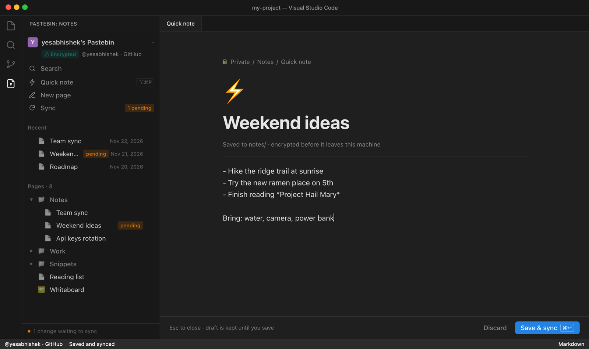
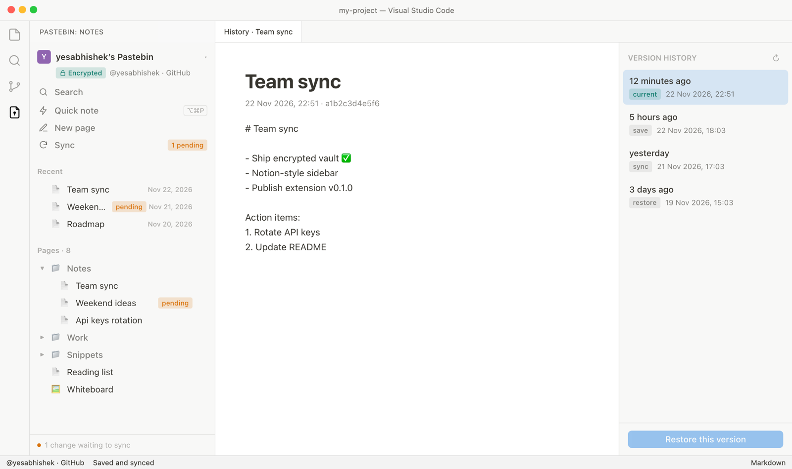
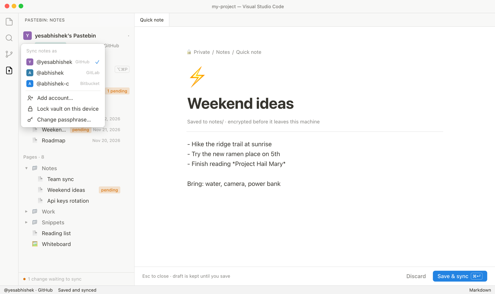

# Pastebin — Encrypted Notes

Private notes inside VS Code. Every note is **end-to-end encrypted on your machine** and synced through a private repository **you own on GitHub, GitLab or Bitbucket**. There is no server and no subscription, and nobody else can read your notes, including your Git host.



## Highlights

- **Clean, focused sidebar** with search, recent pages, folders and sync status.
- **Quick note from anywhere** with <kbd>⌥⌘P</kbd> / <kbd>Ctrl+Alt+P</kbd>. Type a title and some text, press <kbd>⌘↵</kbd>, and it is encrypted, saved and synced.
- **Native editing.** Pages open as regular editor tabs with Markdown and all your editor features. <kbd>⌘S</kbd> syncs.
- **Version history.** Browse decrypted past versions side by side and restore with one click (<kbd>⌥⌘H</kbd>).
- **Your choice of Git host.** GitHub, GitLab (gitlab.com or self-managed) and Bitbucket Cloud.
- **Several accounts.** See which account you sync to and switch at any time.
- **Strong encryption.** AES-256-GCM, with the key protected by your passphrase through Argon2id. Note names are encrypted too.
- **Unlock once per device.** The key and your host tokens are kept in the OS keychain.

| Version history | Accounts |
|---|---|
|  |  |

## Requirements

- The [`pb` CLI](https://github.com/yesabhishek/pastebin-cli#install), version 0.4 or newer:

  ```bash
  curl -fsSL https://raw.githubusercontent.com/yesabhishek/pastebin-cli/main/scripts/install.sh | sh
  ```

- An account on one of the supported hosts:

  | Host | What you need |
  |---|---|
  | GitHub | The [GitHub CLI](https://cli.github.com/), signed in with `gh auth login` |
  | GitLab | A personal access token with the `api` scope |
  | Bitbucket Cloud | Your Atlassian account email and an API token with repository read, write and admin scopes plus account read |

## Getting started

1. Open the **Pastebin** view in the activity bar and click **Get started**.
2. Choose GitHub, GitLab or Bitbucket and sign in. pb creates a **private** repository for your notes.
3. Pick a passphrase. It encrypts your notes, and you enter it once on each new device. **There is no recovery if you forget it.**
4. Press <kbd>⌥⌘P</kbd> and write your first note.

Already using pb on another machine? Sign in to the same account and enter your existing passphrase when asked.

## Commands

| Command | Shortcut |
|---|---|
| Pastebin: Quick Note | <kbd>⌥⌘P</kbd> / <kbd>Ctrl+Alt+P</kbd> |
| Pastebin: Search Pages | <kbd>⌥⌘O</kbd> / <kbd>Ctrl+Alt+O</kbd> |
| Pastebin: Version History | <kbd>⌥⌘H</kbd> / <kbd>Ctrl+Alt+H</kbd> (on a page) |
| Pastebin: New Page | |
| Pastebin: Sync | |
| Pastebin: Switch Account | |
| Pastebin: Add Account (GitHub, GitLab, Bitbucket) | |
| Pastebin: Unlock Vault / Lock Vault on This Device | |
| Pastebin: Change Vault Passphrase | |
| Pastebin: Save Current Editor to Pastebin | |

## Settings

- `pastebin.pbPath`: path to the `pb` binary. Only read from user settings, so a workspace cannot override it.
- `pastebin.syncOnStartup`: sync in the background when VS Code starts (default on).
- `pastebin.autoSync`: sync every 10 minutes while VS Code is focused (default on).

## Privacy and security

- Your Git host only stores ciphertext. Note names and the index are encrypted as well.
- Passphrases and tokens go to `pb` over stdin only, never as command-line arguments, and the extension never stores them.
- GitLab and Bitbucket tokens are verified, then kept in your OS keychain.
- pb refuses to use a repository that is not private.
- Webviews run under a strict Content-Security-Policy: no remote content, and no HTML built from note data.
- In untrusted workspaces, building pb from source is disabled.

## Troubleshooting

- **"Install the pb CLI"**: install pb, or set `pastebin.pbPath` to its full path.
- **"Update the pb CLI"**: run `pb upgrade`.
- **"Vault locked on this device"**: click **Unlock** and enter your passphrase.
- **Token rejected**: run **Pastebin: Add Account** again with a new token that has the scopes listed above.
- **Wrong account?** Click your name at the top of the sidebar and pick another one.

## Development

```bash
cd vscode-extension
npm ci
npm test
npx @vscode/vsce package
```
